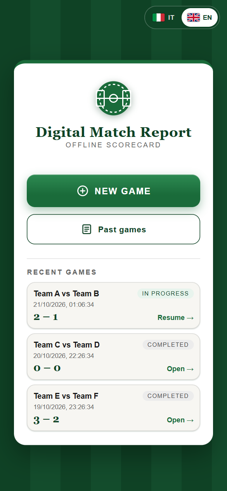
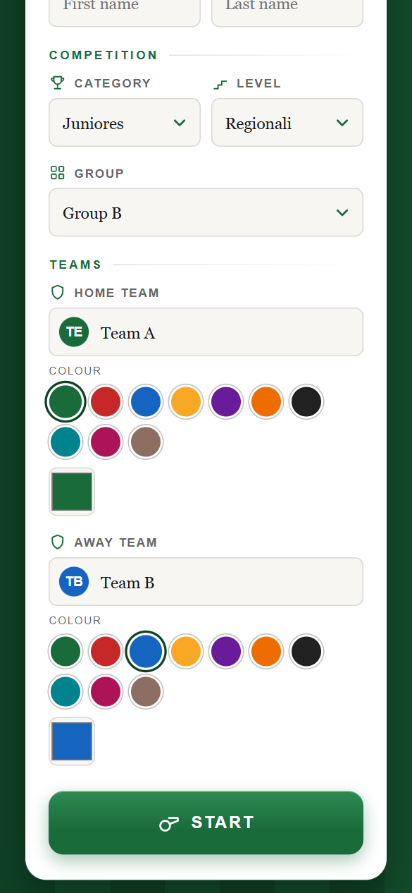
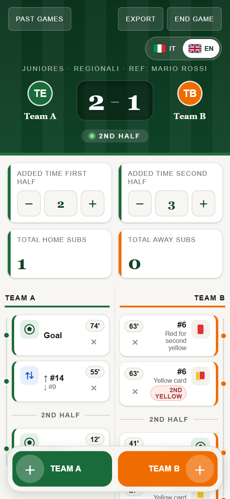
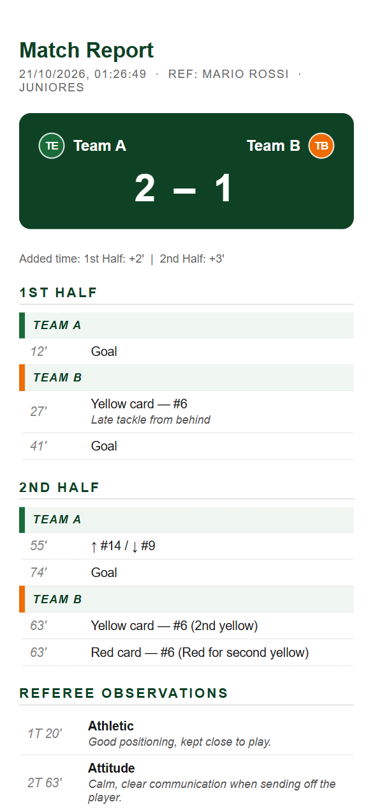
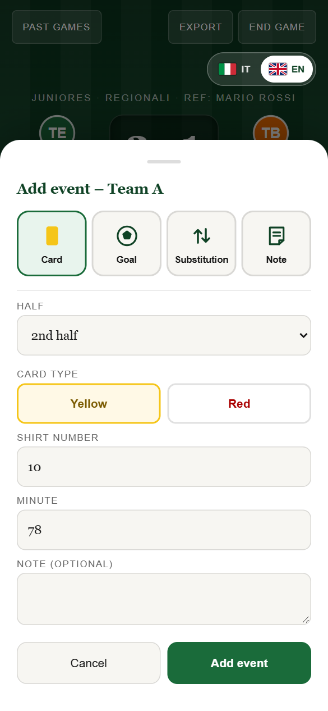

# Digital Match Report

A mobile-first web app for football referees and referee observers. Log goals, cards, substitutions and observations as the match unfolds, then print a clean match summary. Install it on your phone, use it at the pitch, no account needed.

**Live app:** https://mturco3.github.io/Digital-Match-Report/

<p>
  
  
  
  
</p>

## How it works

**1. Set up the match.** Enter referee and supervisor (first and last name), then choose the competition in order: **category** (Juniores, Under 14 to Under 18, Prima, Seconda or Terza Categoria), **level** (Provinciali, Regionali, Regionali Elite, for the categories that have one) and **group** (girone). Then pick the two teams: the search field lists the Lazio clubs of that category, level and group and accepts any other name you type. Each team gets a colour, and the app warns you if the two colours are too similar.

**2. Follow the match.** The live screen shows the score and one event column per team, newest event on top. Tap a team's button to add an event:

| Event | What you enter |
|---|---|
| Goal | Minute |
| Yellow or red card | Shirt number, minute, optional note |
| Substitution | Shirt number out, shirt number in, minute |
| Note | Area (athletic, technical, tactical, attitude), text, minute |

<p>
  
</p>

- Every event is tagged to the first or second half. The score updates from the goals you log, and a wrong entry can be deleted.
- A second yellow card for the same player asks for confirmation and records the red card that follows.
- Booking or substituting a player who was already sent off asks for confirmation first; you can still record it.
- Notes are referee observations that belong to neither team. They appear in their own block under the two columns.
- Added time for each half is set with - and + buttons, and the number of substitutions per team is counted on the same screen.

**3. Print the report.** Tap **Export** to open a match report with the final score, the events by half and team, card notes, observations, added time and substitutions. Print it or save it as a PDF from the browser.

**4. Come back to it later.** Every match is saved on your device. Reopen, review or delete past matches from **Past games**, and end a match to mark it as completed.

**Also included**
- Italian and English interface, switchable at any time with the flags at the top.
- Works offline: the app stores its own files on first load, so it keeps running without a connection.
- Installable: add it to your home screen and it opens like a native app.
- Private by design: matches never leave your device. No account, server or tracking.

## How it is built

A static web app with no framework, no build step and no dependencies.

- **Vanilla HTML, CSS and JavaScript** for the interface, with a shared translation table for Italian and English.
- **`localStorage`** keeps each match as a versioned JSON record, so the data format can evolve. Matches saved by earlier versions still open.
- **A service worker** caches the app files, and a **web app manifest** makes it installable as a PWA.
- **A static team list** (`data/teams.json`, 431 Lazio clubs for the 2026/2027 season) built from the official LND Lazio group lists by the scripts in `tools/teams/`. The app never fetches it from the web at run time. Colours are generated, not the real kit colours.
- **GitHub Pages**, deployed by a GitHub Actions workflow on every push to `main`.
- User-entered text is HTML-escaped before it is shown in the match screen, the history list or the printed report.

```
index.html + js/home.js        home, match setup and history
js/teams.js, js/team-picker.js team list, search, colours and crests
game.html + js/game.js         live match screen, event form, printable report
js/storage.js                  shared storage helpers
css/style.css                  styles
data/teams.json                Lazio clubs by category, level and group
sw.js, manifest.json           offline cache and install support
icons/, tools/                 app icons, icon generator and team-list scripts
Images/                        screenshots used in this README
.github/workflows/static.yml   deployment to GitHub Pages
```

To run it locally, serve the folder over HTTP:

```bash
git clone https://github.com/Mturco3/Digital-Match-Report.git
cd Digital-Match-Report
python -m http.server 8000
# open http://localhost:8000
```

## Author

Michele Turco
